# AILIXIR Architecture & Component Documentation

This document describes the unified AILIXIR platform: its Flutter desktop application, Laravel orchestration backend, and specialized computational components for molecular generation, docking, drug-target prediction, ADMET profiling, chemical retrieval, chemistry assistance, and molecular dynamics. It provides a system-level overview and component-level responsibilities for developers and SREs onboarding onto the project.

## Contents

- System-level architecture (diagram + explanation)
- Data flow and request lifecycle
- Per-service diagrams & responsibilities
  - 1) Laravel (orchestration)
  - 2) ADMET inference (FastAPI)
  - 3) Drug Repurposing (FastAPI)
  - 4) Chemical RAG (FAISS + LLM)
  - 5) Molecular Generation — REINVENT4 (TL/RL-Optimized)
  - 6) Chemistry AI Agent
  - 7) Molecular Docking
  - 8) DeepPurpose Integration
  - 9) Molecular Dynamics
  - 10) Flutter Desktop Application
- Environment variables & configuration locations
- Deployment notes and scaling considerations
- Troubleshooting checkpoints

## System-level architecture (Mermaid)

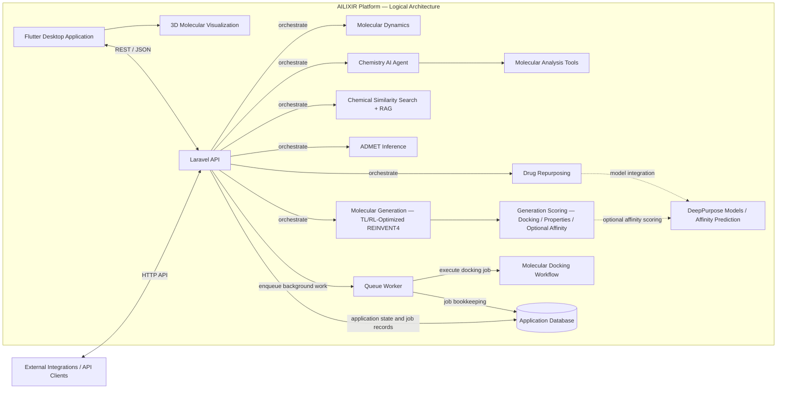

Explanation
-----------

- AILIXIR is one platform with a Flutter desktop interface, a Laravel orchestration backend, and specialized computational components. The diagram groups components by their logical role; it does not represent Docker network boundaries or a container-per-component deployment.
- Flutter provides access to molecular generation, docking, ADMET prediction, drug repurposing, chemical similarity search, the Chemistry AI Agent, molecular dynamics, history, and 3D molecular visualization.
- Laravel handles authentication, request validation, workflow orchestration, application state, and job records. Workflows use direct calls or background jobs according to their implementation. The queue worker shares the Laravel codebase and uses the configured application database for job bookkeeping.
- Molecular generation uses a target-adapted, TL/RL-optimized REINVENT4 checkpoint. During model development, Transfer Learning (TL) adapted the model to target-associated molecular data. Reinforcement Learning (RL) then optimized it using a scoring function incorporating docking-based scores, DeepPurpose affinity predictions, and molecular property and structural criteria. Standard user requests generate candidates from the resulting checkpoint without repeating TL or RL; subsequent evaluation follows the selected run configuration.

- The molecular docking workflow accepts ligand and receptor inputs, runs docking jobs, and returns predicted poses and scores. Docking-based scoring during generation model development and the user-facing docking workflow are distinct capabilities within the same platform.
- DeepPurpose supports drug-target interaction and affinity prediction within drug repurposing and generation-related candidate evaluation. Its model integration is not necessarily a standalone public service. For generation, Docker Compose uses a separate DeepPurpose container, while the Hugging Face build runs DeepPurpose as a local process within the Generation Space on Hugging Face. Drug Repurposing model availability also follows its deployment configuration, including its documented mock mode.
- ADMET provides molecular property predictions; Chemical RAG provides chemical similarity retrieval and optional LLM explanations; the Chemistry AI Agent exposes conversational molecular analysis tools; Molecular Dynamics supports protein-ligand simulation and analysis.
- Deployment depends on the selected environment. Docker Compose services communicate through the `ailixir` bridge network where configured. Selected backend and AI services can instead run in separate Hugging Face Spaces and communicate through configured HTTPS endpoints. Components in this diagram must not be assumed to share one Docker bridge.
- The configured application database stores application state, users, and job metadata. Model artifacts, FAISS indexes, and computational outputs use the storage configured for each component and deployment. See `docker-compose.yml` and `HUGGINGFACE_FLOW.md` for deployment details.

Request lifecycle — typical screening flow
---------------------------------------

1. Client POSTs request to Laravel endpoint (e.g., run screening).
2. Laravel validates and creates a job record in MySQL and either performs synchronous work or enqueues a background job.
3. Background job triggers calls to AI services in parallel or sequence depending on pipeline stage:
   - `drug-repurposing` to run virtual screening
   - `admet` to score ADMET properties
   - `chemical-rag` to fetch similar compounds or augment results
4. AI services return raw predictions to Laravel which aggregates results, persists summary, and notifies the client.

This screening example illustrates one AILIXIR workflow. Generation, docking, Chemistry Agent interactions, and molecular dynamics use their respective workflows; they are not mandatory stages of every screening request.

Per-service diagrams & responsibilities
--------------------------------------

### 1) Laravel (orchestration)

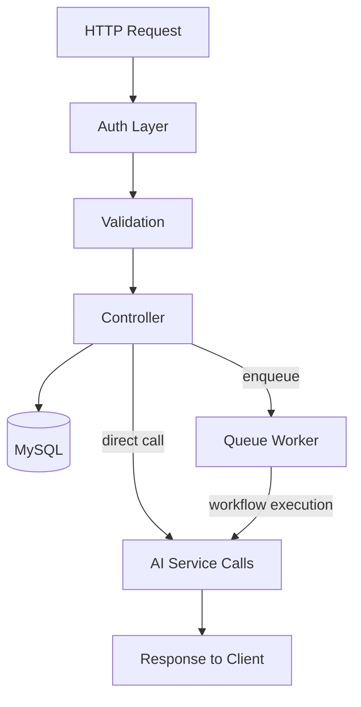

Responsibilities:

- Authentication and authorization (API tokens, OAuth, or guards configured in `config/auth.php`).
- Centralized error handling and logging.
- Exposes REST endpoints used by UI and third-party clients; routes live under `routes/`.
- Job dispatching and scheduling; queue worker executes heavy pipelines.
- Orchestrates generation, docking, drug-target prediction, ADMET, Chemical RAG, Chemistry Agent, and Molecular Dynamics workflows for the Flutter application and other API clients.

Where to look in repository:

- `app/Http/Controllers/` — controllers and endpoints
- `routes/api.php` — API routes and versioning
- `jobs/` and `app/Jobs` — background job implementations
- `docker/laravel.env` — example env values

### 2) ADMET inference (FastAPI)

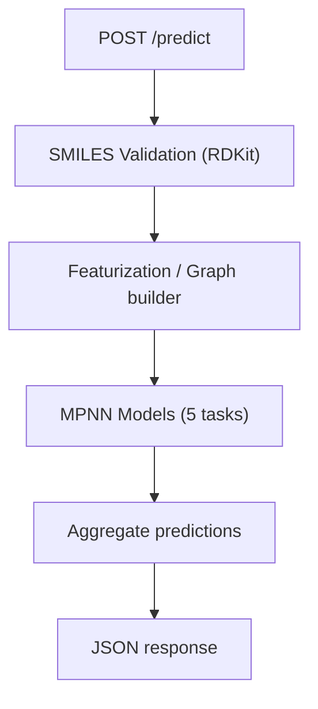

Responsibilities:

- Load pre-trained MPNN models on startup (check `models/` inside service).
- Validate SMILES strings with RDKit and sanitize input.
- Support single and batch prediction endpoints; expose `/health` and `/docs`.
- CPU-optimized inference (no GPU assumed by default) and async handling via Uvicorn.

Where to look:

- `ai_apps/ADMIT/admet_inference/` — service code, `README.md`, `Dockerfile`, `requirements.txt`.
- Health and docs endpoints available at `http://<host>:<port>/health` and `/docs`.

### 3) Drug Repurposing (FastAPI)

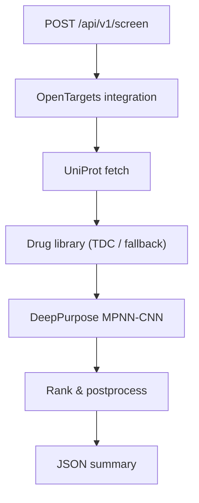

Responsibilities:

- Full screening pipeline: disease→targets→proteins→screening→results.
- Uses DeepPurpose-based drug-target prediction within the screening pipeline; see the DeepPurpose Integration section for its relationship to generation-side candidate evaluation and deployment configuration.
- Integrates external APIs (OpenTargets, UniProt) and TDC for drug libraries.
- Provides mock modes for offline testing (use env `USE_MOCK_MODEL` and `USE_MOCK_DRUGS`).

Where to look:

- `ai_apps/Drug Reporposing/` — service implementation, `docker/` folder, `requirements.txt`, `README.md` and helper scripts (`start.sh`, `start.bat`).

### 4) Chemical RAG (FAISS + LLM)

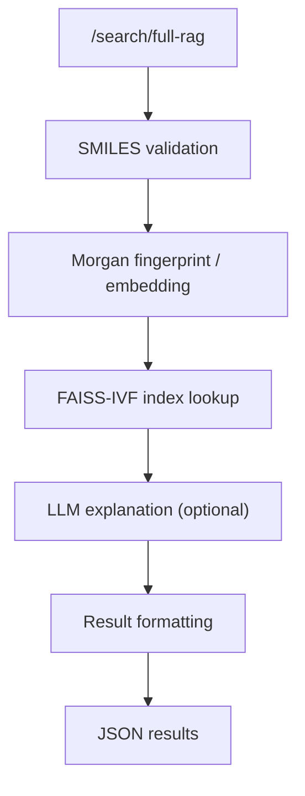

Responsibilities:

- High-performance similarity search for large compound libraries (1M+).
- Persistent FAISS index stored on volume (`chemical-rag-data`).
- Two endpoints: retrieval-only and full RAG (with LLM explanations); auto-detects and ingests compounds on first run.

Where to look:

- `ai_apps/chemical-rag-system/chemical-rag-system/` — engine, ingestion scripts, FAISS index code, `run_server.py`, and `README.md`.

### 5) Molecular Generation — REINVENT4 (TL/RL-Optimized)

AILIXIR uses a target-adapted REINVENT4 checkpoint for molecular generation, developed for the EGFR target.

During model development, Transfer Learning (TL) adapted REINVENT4 to target-associated molecular data. This was followed by a three-stage Reinforcement Learning (RL) workflow whose scoring configuration incorporated docking-based evaluation using AutoDock-GPU, DeepPurpose affinity predictions (DeepPurpose_pAff), molecular properties (MW, cLogP, TPSA, and rotatable bonds), synthetic accessibility (SA), drug-likeness (QED), and unwanted reactive-group filters, as configured for each stage.

The generation-side DeepPurpose predictor was also trained for the EGFR target and integrated into the RL scoring workflow. The EGFR structure represented by PDB entry 4WKQ was used for docking-based evaluation.

During normal application use, generation requests sample molecular candidates from the resulting optimized checkpoint without restarting TL or RL. Generated candidates are processed through the configured evaluation, ranking, and export pipeline, which may include property calculations, affinity prediction, and optional docking.

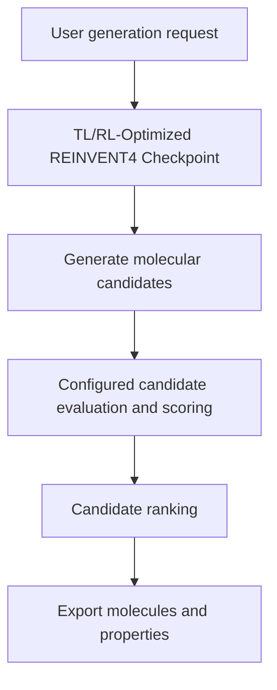

Responsibilities:

- Generate molecular candidates using the target-adapted, TL/RL-optimized REINVENT4 checkpoint.
- Use the trained model for user requests without repeating the model preparation TL/RL stages.
- Evaluate candidates using configured docking-based and other computational scoring.
- Support optional DeepPurpose affinity prediction within candidate evaluation.
- Rank candidates and export generated molecules with their properties.

Where to look:

- `ai_apps/generation/` — generation workflow, configuration, and deployment files.
- `app/Http/Controllers/Api/GenerationController.php` — Laravel generation orchestration.
- `ai_apps/generation/bundle/services/deeppurpose/` — generation-side DeepPurpose integration.

### 6) Chemistry AI Agent

AILIXIR includes a tool-enabled Chemistry AI Agent for conversational chemistry assistance and molecular analysis.

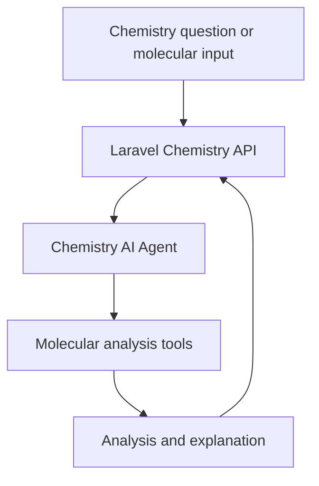

Responsibilities:

- Validate SMILES and analyze molecular structures.
- Calculate physicochemical properties and evaluate drug-likeness.
- Compare molecules and interpret docking results.
- Provide conversational access to chemistry analysis tools.

Docking-result interpretation is an Agent capability; docking job submission and execution are covered in the Molecular Docking section.

Where to look:

- `ai_apps/chem_agent_api/`

### 7) Molecular Docking

AILIXIR exposes a molecular docking workflow for protein-ligand interaction analysis, with its own submission, job history, and result retrieval.

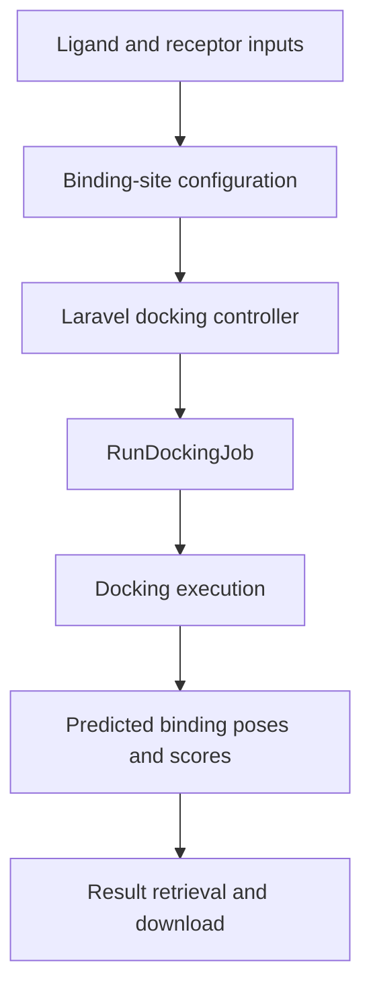

Responsibilities:

- Accept ligand and receptor inputs and binding-site settings.
- Submit and execute docking jobs through the Laravel background-job workflow.
- Return predicted binding poses, docking scores, and downloadable results.
- Expose docking as a platform workflow alongside generation-based scoring and Chemistry Agent result interpretation.

Where to look:

- `app/Http/Controllers/Api/DockingController.php`
- `app/Jobs/RunDockingJob.php`
- `scripts/vina_docking.py`

### 8) DeepPurpose Integration

DeepPurpose-based models support drug-target interaction and affinity prediction. AILIXIR integrates these models within Drug Repurposing and generation-related molecular candidate evaluation.

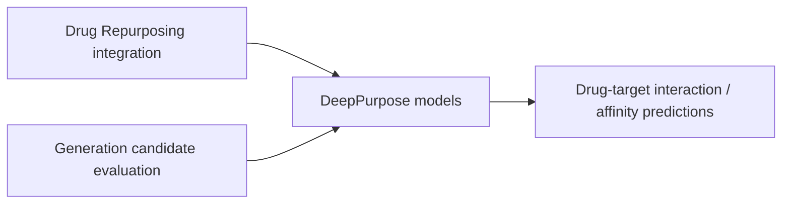

Responsibilities:

- Integrate the EGFR-trained generation-side predictor into REINVENT4 RL scoring through the DeepPurpose_pAff component.
- Predict drug-target interactions and binding affinity from molecular and protein inputs.
- Support screening and ranking within Drug Repurposing.
- Provide optional affinity evaluation for generated candidates.
- Follow the model and mock-mode configuration of the selected deployment.

Deployment context:

- The integrations shown above do not imply that both workflows call the same running model instance.
- For generation, Docker Compose uses the `generation-deeppurpose` container; the Hugging Face generation build runs DeepPurpose locally within the Generation Space.
- The Hugging Face Drug Repurposing build is documented as mock-ready in README.md. The logical architecture therefore does not imply that every deployment runs full DeepPurpose inference.

Where to look:

- `ai_apps/Drug Reporposing/`
- `ai_apps/generation/bundle/services/deeppurpose/`
- `ai_apps/generation/Dockerfile.dp`
- `ai_apps/generation/Dockerfile.hf`
- `ai_apps/generation/start_hf.sh`

### 9) Molecular Dynamics

AILIXIR includes a protein-ligand Molecular Dynamics workflow for simulation setup, execution, monitoring, and analysis.

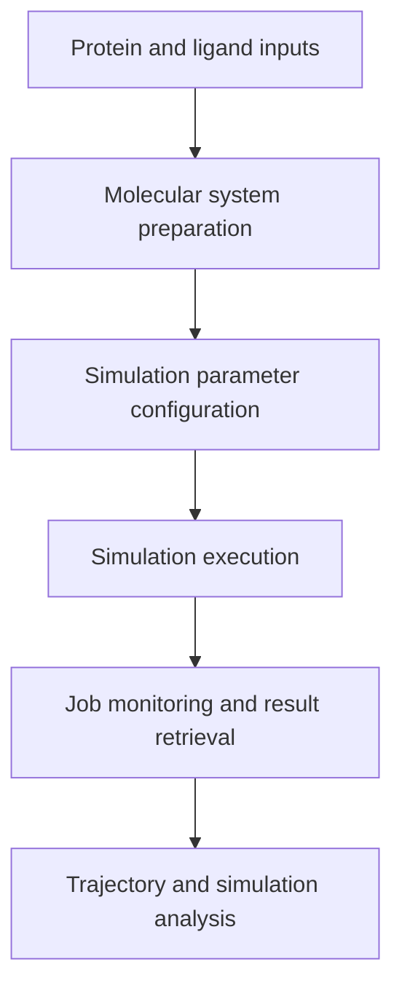

Responsibilities:

- Support protein and ligand preparation and molecular system setup.
- Accept simulation parameter configuration.
- Execute simulations and expose job monitoring and result retrieval.
- Support trajectory and simulation analysis.

Where to look:

- `ai_apps/Protein-Ligand-MD-Simulation/`
- `app/Http/Controllers/Api/MdSimulationController.php`

### 10) Flutter Desktop Application

The Flutter desktop application provides the unified user interface for AILIXIR's computational workflows.

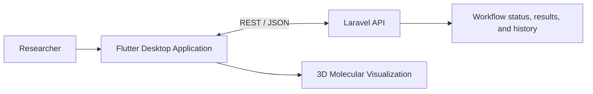

Responsibilities:

- Provide access to molecular generation, docking, ADMET prediction, drug repurposing, chemical similarity search, the Chemistry AI Agent, and molecular dynamics.
- Present workflow status, results, and user history.
- Support interactive 3D molecular visualization.

Where to look:

- Frontend repository: [AILIXIR Flutter](https://github.com/RottenShadow/AiLixir)
- Application releases: [Download AILIXIR](https://github.com/RottenShadow/AiLixir/releases)

## Environment variables & configuration locations

- Root compose: `docker-compose.yml` — service names, build contexts, ports, and env files.
- Laravel env template: `docker/laravel.env` — application and DB defaults.
- Each AI service: check `ai_apps/<service>/` for `requirements.txt`, `Dockerfile`, and service-specific config (e.g., `app/config.py`).

## Production deployment notes

- Resource limits: `docker-compose.yml` contains `deploy.resources.limits` for AI services; tune these for production (memory, CPU).
- Secrets: move sensitive env values into secret managers (Kubernetes Secrets, Vault) in production.
- HTTPS: terminate TLS at a reverse proxy in front of `laravel` (Nginx/Load Balancer) and restrict internal-only exposure for AI services.

## Scaling considerations

- Horizontal scaling of AI services: deploy multiple replicas behind a load balancer. Ensure models are loaded on container start and center model size is within available RAM.
- FAISS index: store on a shared volume or use a dedicated retrieval service with replicated indices.
- Database: use managed RDS/MariaDB clusters or replicas for HA.

## Troubleshooting checkpoints

- Service not healthy: `docker compose logs -f <service>` and `docker compose ps` to check ports and status.
- Model load errors: inspect service logs, confirm model files under `models/` or configured model path.
- FAISS ingestion slow: watch `chemical-rag` logs on first-run ingestion; ensure sufficient CPU and disk I/O.

## Appendix — quick visual references

- Root system diagram: see top of this file (Mermaid block).
- Per-service diagrams: each service section above contains its own Mermaid block.
